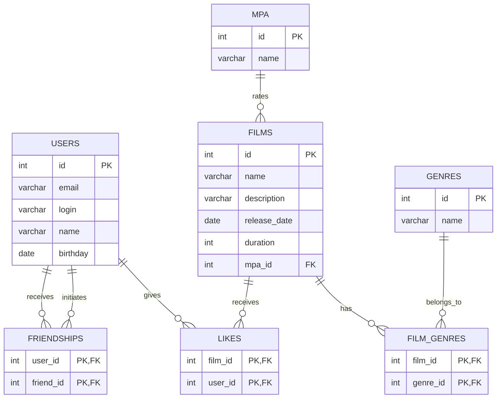

# java-filmorate

Filmorate — REST API для работы с фильмами и пользователями, реализованное на Java 21 и Spring Boot.

Приложение позволяет создавать и обновлять фильмы и пользователей, управлять дружбой, ставить лайки фильмам и получать рейтинг популярных фильмов.

## Технологии

- Java 21
- Spring Boot
- Spring JDBC (`JdbcTemplate`)
- H2 Database
- Maven
- JUnit 5

## Структура базы данных

База данных содержит семь таблиц:

| Таблица | Назначение |
|---|---|
| `users` | Информация о пользователях |
| `films` | Информация о фильмах |
| `mpa` | Возрастные рейтинги фильмов |
| `genres` | Справочник жанров |
| `film_genres` | Связь фильмов с жанрами |
| `likes` | Лайки пользователей |
| `friendships` | Односторонняя дружба пользователей |

## ER-диаграмма

## Основные связи

- **Фильмы и MPA:** один рейтинг может соответствовать нескольким фильмам.
- **Фильмы и жанры:** связь многие ко многим через `film_genres`.
- **Фильмы и пользователи:** связь многие ко многим через `likes`.
- **Пользователи и дружба:** связь пользователей через `friendships`. Дружба односторонняя, поэтому добавление пользователя в друзья не создаёт обратной связи автоматически.

## API

Основные эндпоинты:

- `GET /films` — получить все фильмы.
- `POST /films` — создать фильм.
- `PUT /films` — обновить фильм.
- `GET /films/popular` — получить популярные фильмы.
- `GET /users` — получить пользователей.
- `POST /users` — создать пользователя.
- `PUT /users` — обновить пользователя.
- `GET /genres` — получить жанры.
- `GET /genres/{id}` — получить жанр по ID.
- `GET /mpa` — получить рейтинги MPA.
- `GET /mpa/{id}` — получить рейтинг MPA по ID.

Также поддерживаются операции с лайками фильмов и дружбой пользователей.

## Тестирование

Для проверки работы DAO реализованы интеграционные тесты с использованием JUnit 5, Spring `@JdbcTest` и H2.